# Doctor Tracker — Web

> Secure admin console for managing doctors, their patients and care-network analytics.
> **Frontend repository** · Backend: [doctor-tracker-api](https://github.com/anikcse19/doctor-tracker-api)

| | |
|---|---|
| **Live app** | https://doctor-tracker-web-phi.vercel.app |
| **Live API** | https://doctor-tracker-api-54fy.onrender.com/api/v1/health |
| **Demo login** | `admin@doctortracker.app` / `CareGuide@2026` |

> The API runs on Render's free tier and sleeps after 15 minutes idle. The first request can take up to ~50 s; the login page detects this and shows a "waking up the server" notice.

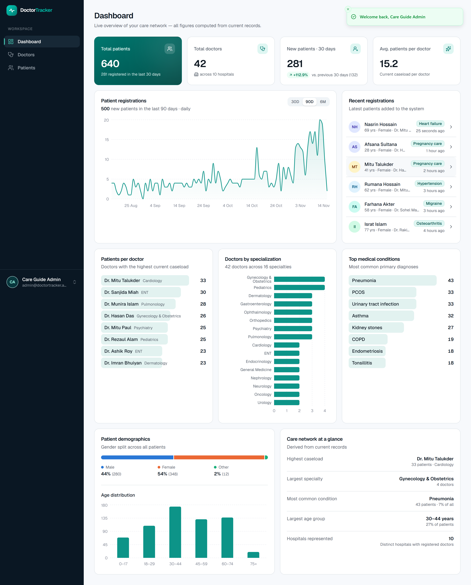

---

## Elevator pitch

Doctor Tracker gives a healthcare administrator one clear view of their care network. Admins sign in securely, register doctors, attach patients to them, and search, filter and paginate both lists by name, specialization, hospital, medical condition, gender and registration date. A live dashboard turns the records into decisions: patient registration trends, workload per doctor, specialty coverage, the most common conditions and patient demographics — every figure computed by MongoDB aggregations over real data, never hard-coded.

---

## Contents

1. [Features](#features)
2. [Tech stack](#tech-stack)
3. [Setup guide](#setup-guide)
4. [System architecture](#system-architecture)
5. [Technical decisions](#technical-decisions)
6. [Visual evidence](#visual-evidence)
7. [Security](#security)
8. [Performance](#performance)
9. [Testing & quality](#testing--quality)
10. [Project structure](#project-structure)

---

## Features

**Authentication** — HttpOnly-cookie session, protected routes (edge `proxy.ts` guard + server-side verification), session-expiry handling, sign-out that wipes all cached data, brute-force rate limiting.

**Doctors** — create & edit · list with debounced search (name/email/phone/hospital) · filter by specialization, hospital and joined-date range · sort · server-side pagination · profile page with live stats (patient count, most common condition, latest registration, gender mix) · the doctor's own patient list with add / edit / delete.

**Patients** — list across all doctors · search (name/phone/email/condition) · filter by medical condition, gender, registration-date range · sort · pagination · detail page with assigned doctor · edit (including reassigning to another doctor) · delete with confirmation.

**Dashboard** — KPI tiles (patients, doctors, 30-day registrations with % change, average caseload) · registration trend (30 days / 90 days / 6 months, Asia/Dhaka buckets) · patients per doctor · doctors by specialization · top conditions · gender split · age distribution · recent registrations · derived "network at a glance" facts.

**UX** — skeleton loaders shaped like the real content, designed empty states (distinguishing "no data yet" from "no results for these filters"), toast feedback, confirmation dialogs, inline server-side validation errors (e.g. duplicate email), URL-synced filters (shareable & back-button friendly), responsive layouts with card lists on mobile, keyboard-accessible Radix primitives, skip link, visible focus rings.

---

## Tech stack

| Concern | Choice | Why |
|---|---|---|
| Framework | **Next.js 16 (App Router)**, React 19, TypeScript | Server Components, streaming, Cache Components, `proxy.ts` route guard |
| Styling / UI | **Tailwind CSS v4 + shadcn/ui (Radix)** | Accessible primitives that we own and theme — not a stock look |
| Server state | **TanStack Query v5** | Caching, request de-duplication, `keepPreviousData` paging, targeted invalidation |
| URL state | **nuqs** | Type-safe search-param state for filters/sort/page |
| Forms | **React Hook Form + Zod** | Uncontrolled inputs (few re-renders) + schemas mirroring the API |
| Charts | **Recharts** (via shadcn chart wrappers) | Composable SVG charts with accessible tooltips |
| Misc | sonner (toasts), lucide-react (icons), date-fns | Small, tree-shakable |

Backend: **Express 5 · MongoDB Atlas · Mongoose 9 · Zod** — see the [API README](https://github.com/anikcse19/doctor-tracker-api#readme).

---

## Setup guide

### Prerequisites

- **Node.js ≥ 20.19** (developed on Node 24) and npm
- A **MongoDB** database — a free [MongoDB Atlas](https://www.mongodb.com/atlas) M0 cluster works
- Git

### 1. Clone both repositories side by side

```bash
git clone https://github.com/anikcse19/doctor-tracker-api.git
git clone https://github.com/anikcse19/doctor-tracker-web.git
```

### 2. Start the API (terminal 1)

```bash
cd doctor-tracker-api
npm install
cp .env.example .env          # then edit .env — see below
npm run seed                  # creates the demo admin + 42 doctors + 640 patients
npm run dev                   # http://localhost:4000/api/v1/health
```

Required values in `doctor-tracker-api/.env`:

| Variable | Example | Notes |
|---|---|---|
| `MONGODB_URI` | `mongodb+srv://<user>:<password>@<cluster>.mongodb.net/?retryWrites=true&w=majority` | Your Atlas connection string |
| `JWT_SECRET` | 64+ random chars | `node -e "console.log(require('crypto').randomBytes(48).toString('hex'))"` |
| `SEED_ADMIN_EMAIL` / `SEED_ADMIN_PASSWORD` | `admin@doctortracker.app` / `CareGuide@2026` | Demo account created by the seed |

> **Windows + `querySrv ECONNREFUSED`?** Some machines run a local DNS proxy that refuses SRV lookups. Add `DNS_SERVERS=8.8.8.8,1.1.1.1` to `.env` (local dev only).

### 3. Start the web app (terminal 2)

```bash
cd doctor-tracker-web
npm install
cp .env.example .env.local    # API_URL=http://localhost:4000
npm run dev                   # http://localhost:3000
```

Open http://localhost:3000 and sign in with the demo account.

| Variable | Default | Notes |
|---|---|---|
| `API_URL` | `http://localhost:4000` | **Server-only.** Used by the `/api/*` rewrite and by Server Components. Never exposed to the browser. |

### Scripts

| Command | |
|---|---|
| `npm run dev` | Dev server (Turbopack) |
| `npm run build` / `npm start` | Production build / serve |
| `npm run lint` | ESLint (Next + TypeScript rules) |

### Demo account

`admin@doctortracker.app` / `CareGuide@2026` — created by `npm run seed` in the API repo. Re-running the seed resets the demo data (it replaces doctors and patients and re-hashes the admin password from `.env`). There is intentionally **no public sign-up**: this is an internal admin tool, so accounts are provisioned by the seed script.

---

## System architecture

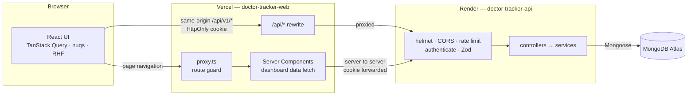

### Frontend architecture

- **Route groups**: `app/login` (public) and `app/(app)/*` (authenticated shell with sidebar).
- **Feature folders** (`src/features/{auth,doctors,patients,dashboard}`) each own their API hooks, Zod schemas and components; `src/components/shared` holds the design-system pieces (page header, list card, pagination, filters, empty/error states, confirm dialog, form field); `src/components/ui` holds the themed shadcn primitives.
- **Server vs. client components**:
  - The app shell and page frames are Server Components and are **prerendered into the static shell** (Cache Components / Partial Prerendering) — they paint instantly.
  - The **dashboard fetches on the server** (`lib/api/server.ts` forwards only the session cookie, `cache: 'no-store'`) and streams behind `<Suspense>` with a layout-matched skeleton. Charts are small client islands that receive data as props.
  - The **interactive lists and detail pages** are client components backed by TanStack Query, because they are driven by rapidly-changing filter state and mutations.
- **Route protection** is two-layered: `proxy.ts` redirects requests with no session cookie before any rendering (fast UX), and the API verifies the JWT on every request (the real security boundary). A global 401 handler in the QueryClient sends expired sessions back to `/login?session=expired&next=…`.

### Authentication flow

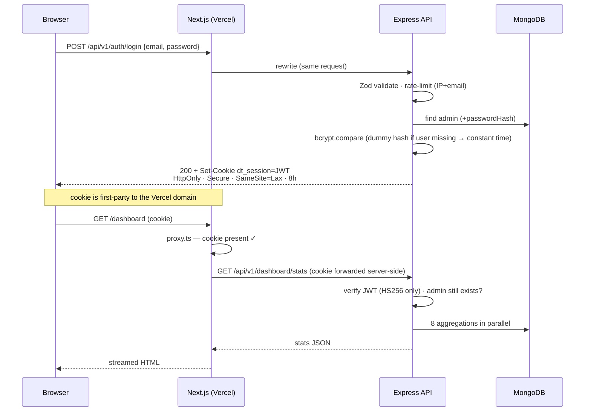

### API communication & data flow

- The browser **only ever talks to its own origin**. `next.config.ts` rewrites `/api/:path*` to the Express API, so the session cookie is first-party and CORS never has to be opened to browsers.
- `lib/api/client.ts` is a ~90-line typed `fetch` wrapper: builds query strings (dropping empty values), unwraps the `{ success, data, meta }` envelope, and throws a typed `ApiError(status, code, message, details)`.
- **Reads**: `useDoctors(query)` / `usePatients(query)` etc. — query keys include the full filter object, so every filter combination is cached independently and revisiting one is instant.
- **Writes**: mutations invalidate the affected key trees (`['doctors']`, `['patients']`) — a patient change also refreshes doctor counts/stats. The dashboard re-renders on the server on every visit, so it is always current.
- **Validation errors**: `applyServerErrors()` maps API `422`/`409` field details onto the matching form inputs (e.g. "This email is already in use" appears under the email field).

---

## Technical decisions

### 1. Two repos, one origin: Next.js as a thin BFF in front of Express

**Problem.** The brief asks for a Next.js full-stack app *and* separate frontend/backend repos using Express. Hosting them on different domains (`*.vercel.app` and `*.onrender.com`) creates a **cross-site cookie** problem: an auth cookie set by the API's domain is a third-party cookie from the app's point of view, and Safari (ITP) and Chrome's third-party-cookie protections block or partition it. The alternatives each have a cost:

| Option | Trade-off |
|---|---|
| JWT in `localStorage` + `Authorization` header | Works cross-domain, but any XSS can steal the token |
| `SameSite=None; Secure` cookie on the API domain + CORS with credentials | Blocked by third-party-cookie protections; requires opening CORS to browsers |
| Next.js Route Handlers as the whole backend | Fails the "separate Express backend repo" requirement |
| **Next.js rewrite `/api/*` → Express (chosen)** | One extra hop through Vercel's edge (≈ tens of ms) |

**Decision.** Express owns *all* business logic, validation and data access (one source of truth). Next.js rewrites `/api/*` to it, so from the browser's perspective there is a single origin: the cookie is first-party, `HttpOnly` (unreadable by JS), `SameSite=Lax` (not sent on cross-site POSTs → CSRF mitigation) and the API's CORS allowlist doesn't need to admit browsers at all. Server Components call the API server-to-server, forwarding just the session cookie.

**Consequence I had to handle.** Behind the rewrite every request reaches Express from Vercel's IPs, so an IP-based login limiter would put *all* users in one bucket — one person mistyping a password five times would lock the shared demo account for everyone. The API therefore takes `TRUST_PROXY_HOPS` (2 in production: Vercel → Render) so `req.ip` is the real client IP, and keys the limiter on **IP + email**.

### 2. State strategy: server cache + URL — no global client store

There is almost no *client-owned* global state in an admin CRUD app. Instead of Redux/Zustand, state lives where it naturally belongs:

| State | Home | Why |
|---|---|---|
| Server data (lists, details, options) | **TanStack Query** | It's a cache of the server, not app state: de-duplication, background refresh, retries (but never on 4xx), and invalidation by key prefix |
| Filters, search, sort, page, page size | **The URL** (nuqs) | Shareable links (`/patients?condition=Asthma&gender=female`), survives refresh, back button works, and the dashboard can deep-link into a filtered list |
| Form state | **React Hook Form** | Uncontrolled inputs → re-render only on validation, not every keystroke |
| Dashboard data | **Server Component** | Computed per request on the server; no client cache needed, no loading waterfall |

Details that make it feel fast: search is debounced 300 ms before it becomes part of the query key; `placeholderData: keepPreviousData` keeps the current page visible while the next loads (with a thin progress bar instead of a skeleton flash); any filter change resets to page 1; deleting the last row on a page steps back a page.

**Trade-off:** filter state in the URL means the URL is the API — parsers validate it (`parseAsStringLiteral` for enums) so a hand-edited URL can't produce an invalid request, and the API validates again regardless.

### 3. Pagination & indexing strategy (API side — summarized)

Offset pagination (`page`/`limit`, `limit ≤ 100`) with `find` and `countDocuments` run **in parallel**, a stable `_id` tiebreaker on every sort, and compound indexes shaped like the queries (`{ doctor, createdAt, _id }`, `{ condition, createdAt, _id }` …) so each page is an index walk with no in-memory sort. Verified with `explain()`: documents examined == documents returned. Offset is the right choice here because admins need page numbers and totals; keyset (cursor) pagination is the documented upgrade for infinite scroll or very deep pages. Full write-up in the [API README](https://github.com/anikcse19/doctor-tracker-api#technical-decisions).

---

## Visual evidence

All screenshots are from the **live deployment** with seeded data.

### Desktop

| Sign in | Dashboard |
|---|---|
| 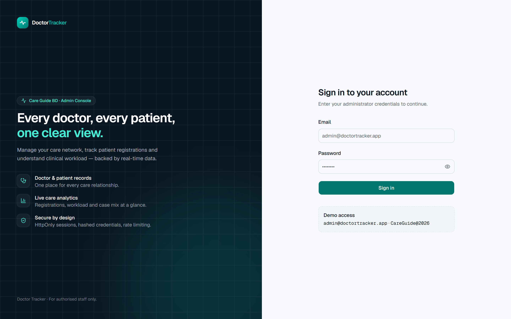 |  |

| Doctors | Filtered by specialization |
|---|---|
| 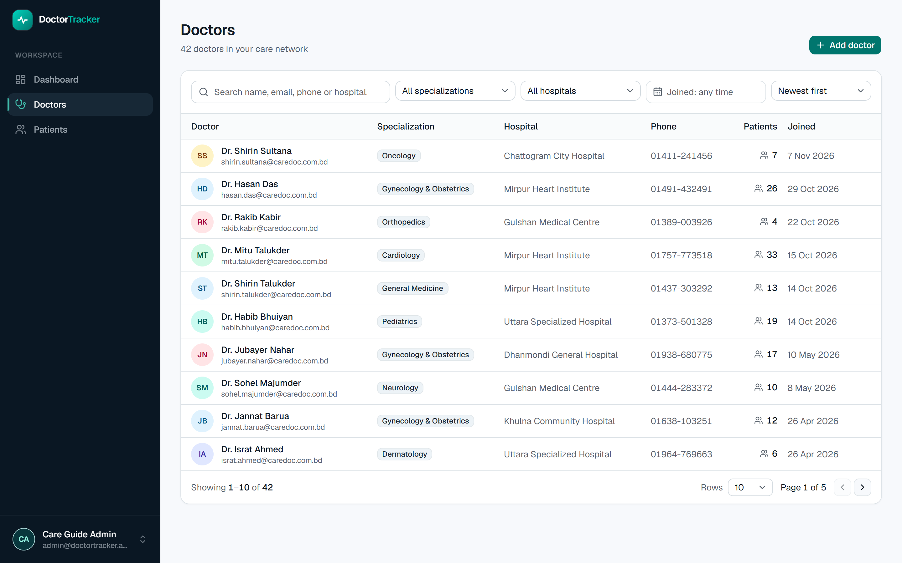 | 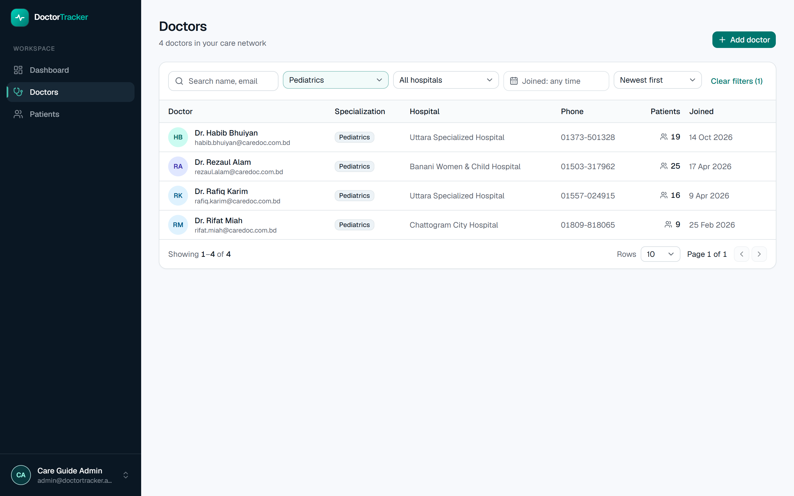 |

| Doctor profile & patient list | Add patient — validation |
|---|---|
| 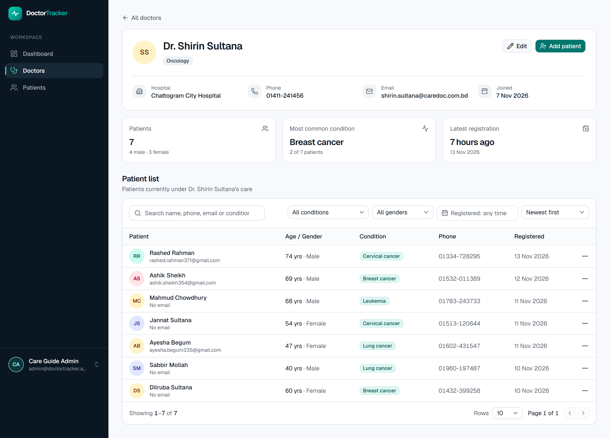 | 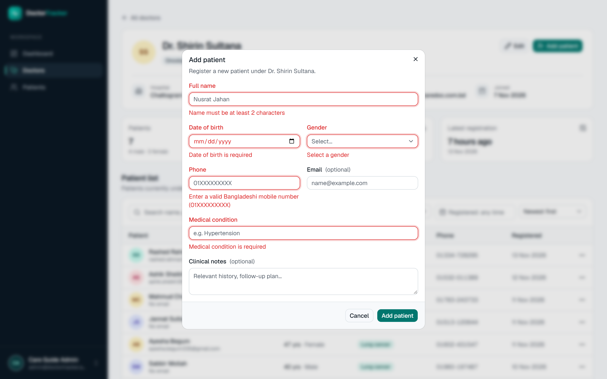 |

| Patients filtered by condition | Patient record |
|---|---|
| 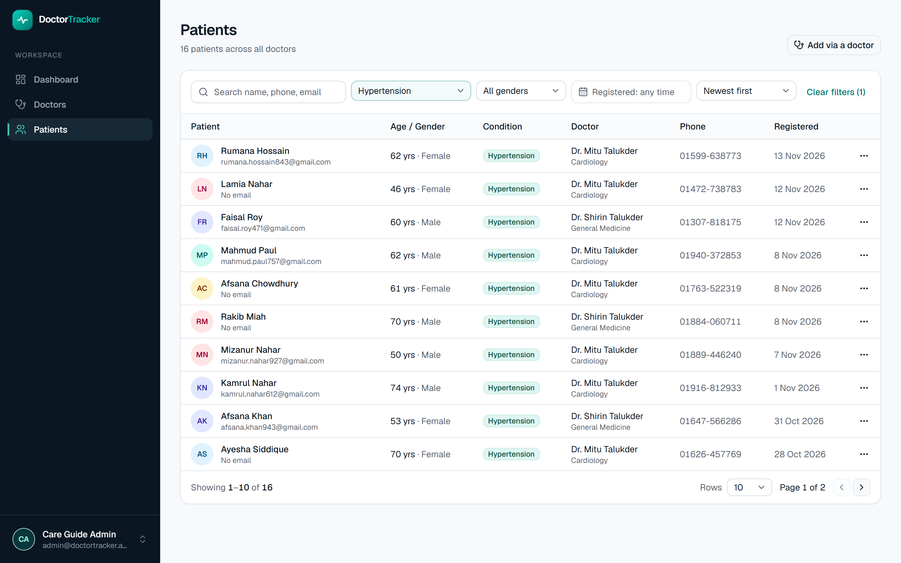 | 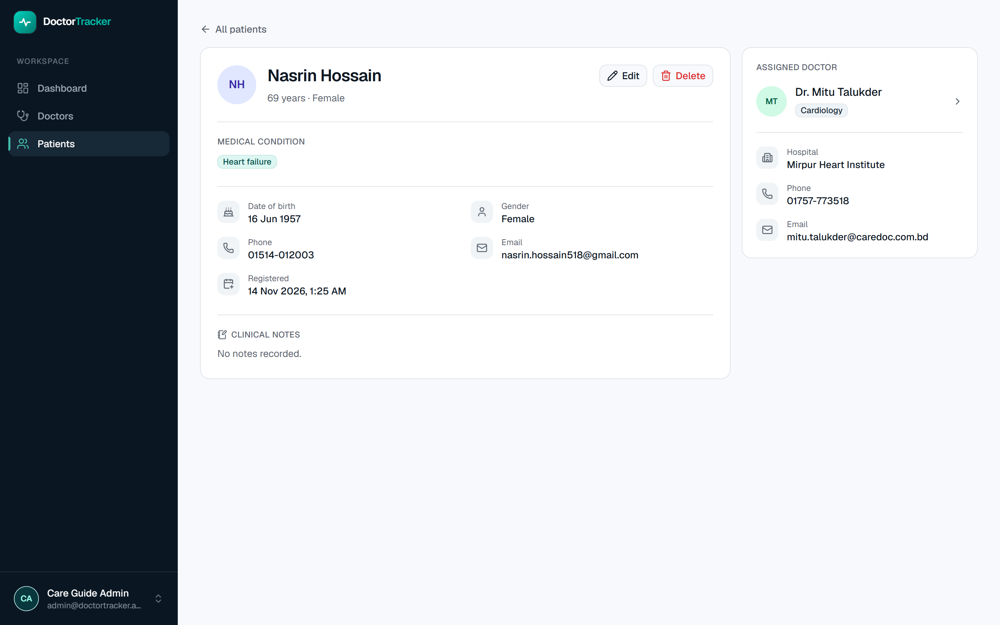 |

| Delete confirmation | Empty search state |
|---|---|
| 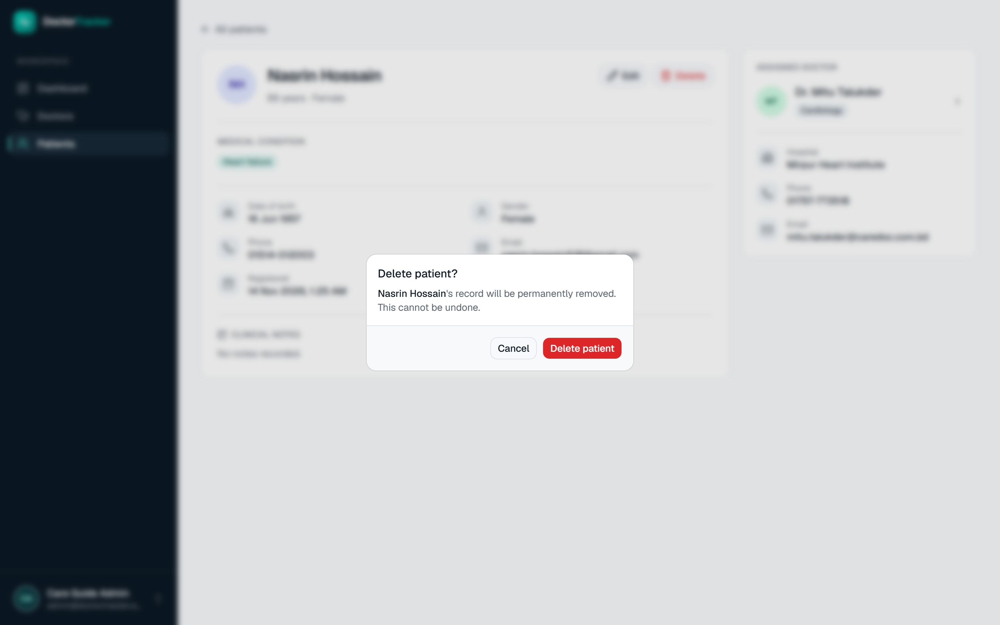 | 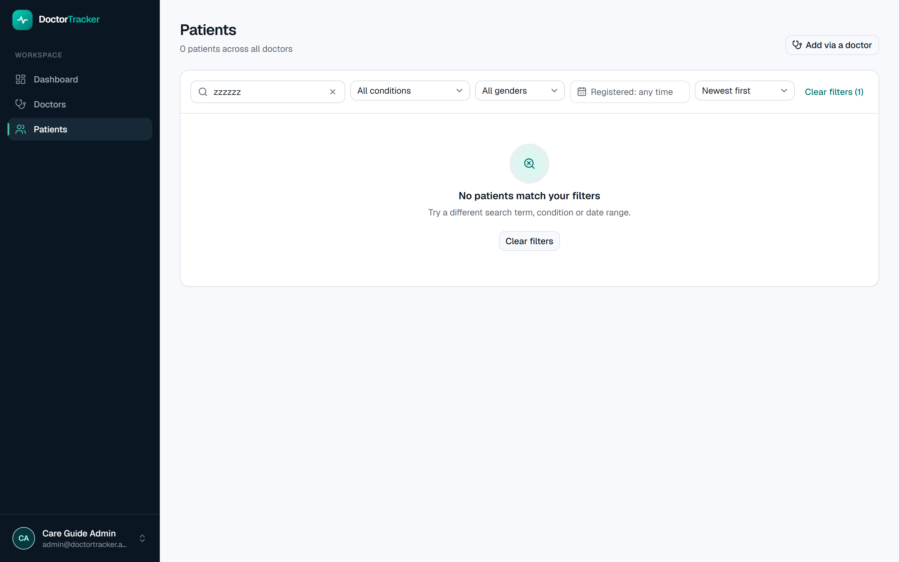 |

### Tablet & mobile

| Tablet dashboard | Mobile dashboard | Mobile doctors | Mobile patients | Mobile navigation |
|---|---|---|---|---|
| 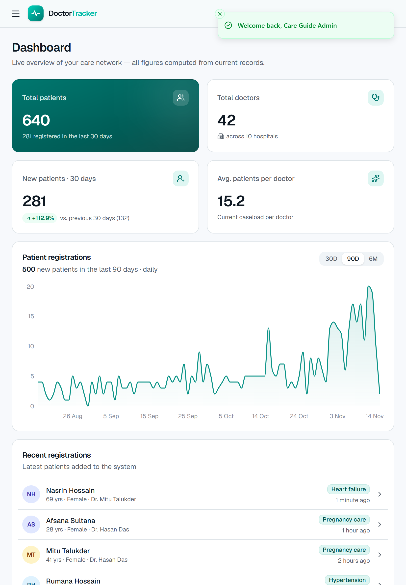 | 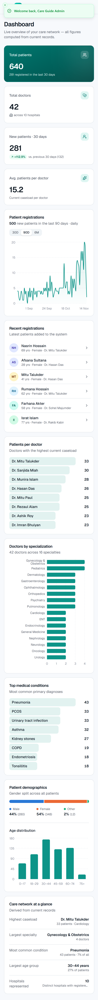 | 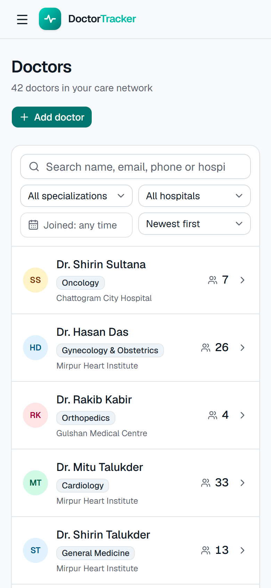 | 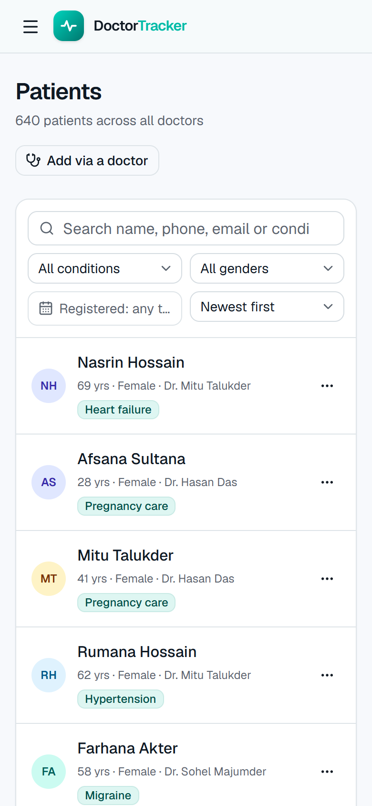 | 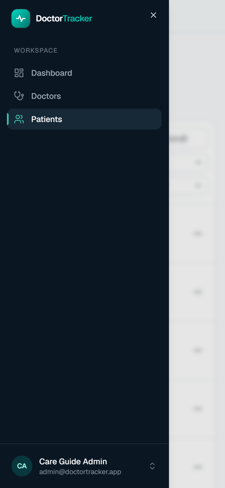 |

---

## Security

- Session JWT lives only in an **HttpOnly, Secure, SameSite=Lax** cookie — never in JS-readable storage, never in a response body.
- The JWT secret exists only in the API's environment; the frontend never verifies tokens itself.
- `proxy.ts` guards app routes; the API re-verifies on every request (and checks the admin still exists).
- Open-redirect protection on `?next=` (only same-site relative paths are honoured).
- Sign-out and session expiry discard all cached patient data (expiry does a full reload).
- Security headers: `X-Frame-Options: DENY`, `X-Content-Type-Options: nosniff`, `Referrer-Policy`, `Permissions-Policy`; `poweredByHeader` disabled; `robots: noindex`.
- No secrets in the repo — `.env*` is git-ignored, only `.env.example` is committed.

## Performance

- App shell and page frames are **prerendered** (Partial Prerendering) — only data streams.
- Dashboard data is fetched **on the server in one request** (8 aggregations run in parallel in the API) — no client waterfall.
- Lists: server-side pagination, debounced search, per-filter query caching, `keepPreviousData` (no flicker), request cancellation via `AbortSignal` when filters change.
- Charts are client islands; everything else on the dashboard renders on the server.
- Forms use uncontrolled inputs (React Hook Form).

## Accessibility

Radix primitives (keyboard support, focus management, ARIA) · skip-to-content link · labelled inputs with errors linked to fields · `aria-current` navigation · charts paired with direct value labels or text summaries, a colour-blind-validated categorical palette, and a single brand hue for magnitude charts · changes vs. previous period shown with arrow + sign + text, not colour alone.

## Testing & quality

- `tsc --noEmit` and ESLint clean; production build passes.
- **End-to-end browser run against the live deployment** (Playwright driving Chrome): wrong-password error → login → create doctor → duplicate-email inline 409 → debounced search → add patient → edit & reassign → filter → delete with confirmation → sign-out → protected-route redirect. All steps pass with no application console errors.
- Visual checks at 1440 px, 820 px and 390 px widths.

## Project structure

```
src/
├─ app/
│  ├─ login/page.tsx                 public sign-in (split brand panel)
│  ├─ (app)/layout.tsx               authenticated shell (sidebar, mobile drawer)
│  ├─ (app)/dashboard/               Server Component + Suspense + error boundary
│  ├─ (app)/doctors/ · [id]/
│  ├─ (app)/patients/ · [id]/
│  └─ layout.tsx · not-found.tsx
├─ proxy.ts                          route guard (cookie presence)
├─ components/
│  ├─ ui/                            themed shadcn/Radix primitives
│  ├─ shared/                        design-system building blocks
│  └─ layout/                        sidebar, mobile nav, user menu
├─ features/
│  ├─ auth/        hooks, login form, session state
│  ├─ doctors/     api hooks, schema, list/detail views, form dialog, URL params
│  ├─ patients/    api hooks, schema, table, filters, form dialog, actions
│  └─ dashboard/   KPI cards, charts, bar lists, range tabs
├─ hooks/          use-debounced-value
└─ lib/            api client (browser + server), errors, types, constants, formatting
```

## Deployment

| | Platform | Notes |
|---|---|---|
| Web | **Vercel** | Env: `API_URL=https://doctor-tracker-api-54fy.onrender.com` |
| API | **Render** (Blueprint `render.yaml`) | Env: `MONGODB_URI`, generated `JWT_SECRET`, `CORS_ORIGINS`, `TRUST_PROXY_HOPS=2` |
| DB | **MongoDB Atlas** M0 | Network access `0.0.0.0/0` (Render free tier has no static egress IP) protected by a strong, dedicated DB user |
